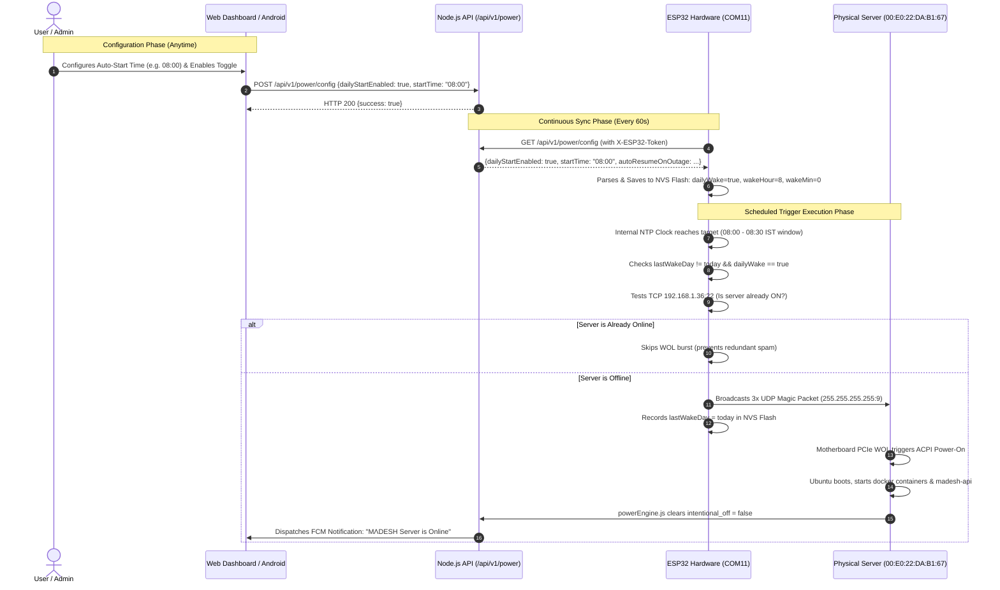
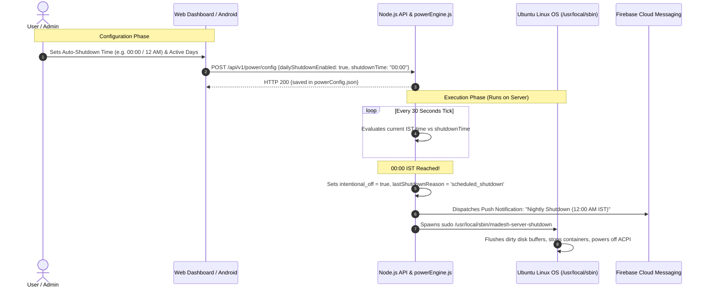
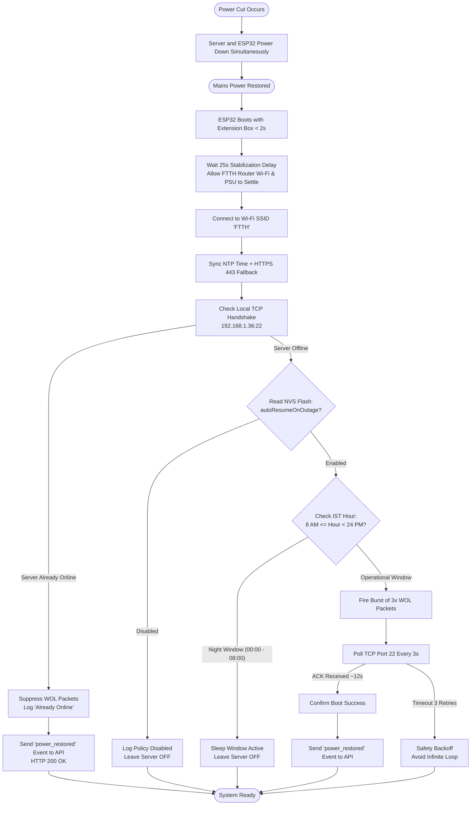
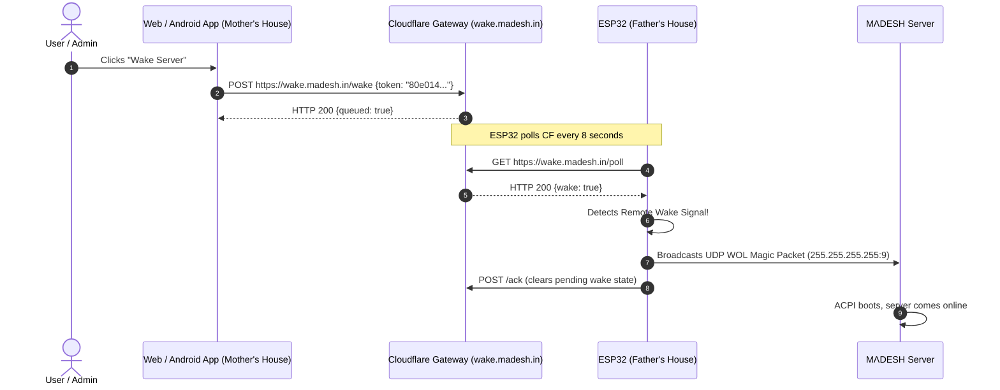

# MΛDESH Server & Web Architecture

Last Updated: 2026-10-11 18:30 IST | Production-Ready v1.0 Architecture

---

## 1. System Topology & Dual-Site Network Architecture

```text
┌────────────────────────────────────────────────────────────────────────────────────────┐
│                               MOTHER'S HOUSE (Remote Site)                             │
│                                                                                        │
│   ┌──────────────────────────────┐              ┌──────────────────────────────────┐   │
│   │   React / Vite Web Client    │              │  MΛDESH Server Control Android   │   │
│   │   - https://cloud.madesh.in  │              │  - Native Kotlin / Jetpack App   │   │
│   │   - http://127.0.0.1:5173    │              │  - Dual Auth: Token + Firebase   │   │
│   └──────────────┬───────────────┘              └────────────────┬─────────────────┘   │
└──────────────────┼───────────────────────────────────────────────┼─────────────────────┘
                   │                                               │
                   ▼                                               ▼
      Cloudflare Ingress (HTTPS) & Tailscale WireGuard Mesh (100.79.42.30)
                   │                                               │
┌──────────────────▼───────────────────────────────────────────────▼─────────────────────┐
│                            FATHER'S HOUSE (Physical Server Site)                       │
│                                                                                        │
│   FTTH Wi-Fi Router (SSID: FTTH | Gateway: 192.168.1.1 | Subnet: 192.168.1.0/24)      │
│                                                                                        │
│   ┌─────────────────────────────────────────┐   WOL UDP:9   ┌──────────────────────┐   │
│   │   NodeMCU ESP32 Automation Controller   │──────────────►│  MΛDESH Server Host  │   │
│   │   - IP: 192.168.1.x (DHCP)              │  (Broadcast)  │  (enp2s0 Interface)  │   │
│   │   - NTP IST Clock (+5:30)               │               │  - MAC:              │   │
│   │   - HTTPS Date: Fallback (Port 443)     │◄──────────────┤    00:E0:22:DA:B1:67 │   │
│   │   - NVS Flash Memory (Preferences.h)    │  TCP :22 ACK  │  - LAN: 192.168.1.36 │   │
│   │   - Polls https://wake.madesh.in/poll   │ (Boot Check)  │  - Tailscale:        │   │
│   │   - Syncs /api/v1/power/config (60s)    │               │    100.79.42.30      │   │
│   │   - Shared Power Extension Box          │               │  - Ubuntu 24.04 LTS  │   │
│   └─────────────────────────────────────────┘               │  - Node.js API (:3001)│  │
│                                                             └──────────────────────┘   │
└────────────────────────────────────────────────────────────────────────────────────────┘
```

---

## 2. Core Automation Workflows

### 🔄 Workflow 1: End-to-End Autonomous Auto-ON (Configurable 24h Time)



---

### 🌙 Workflow 2: End-to-End Autonomous Auto-OFF (Configurable 24h Time)



---

### ⚡ Workflow 3: Zero-API Local Power Outage Recovery Engine



---

### 🚀 Workflow 4: Remote On-Demand Wake (Cloudflare Gateway)



---

## 3. Storage Hierarchy & Disk Topology

The physical server uses a tri-tier storage layout designed for workload isolation and thermal management:

| Tier | Drive | Device & Model | Mount Path | Purpose & Active Workloads |
|---|---|---|---|---|
| **Tier 1** | **Consistent SSD (128 GB)** | `sdc` / LVM `/dev/ubuntu--vg-ubuntu--lv` | `/` | Ubuntu 24.04 OS, systemd daemons, root filesystem, Docker container overlays. |
| **Tier 2** | **Primary Seagate HDD (1.00 TB • 7200 RPM)** | `sdb` / `ST1000DM003` | `/storage/seagate` | **Primary High-Speed HDD**: Active Git repositories, Opus AI data (`/storage/seagate/opus/data`), Keep SQLite database & uploads (`/storage/seagate/keep`), Windows Samba SMB share (`\\100.79.42.30\Seagate`). |
| **Tier 3** | **Secondary WD Blue HDD (1.00 TB • 5400 RPM)** | `sda` / `WD10EZRZ-00H` | `/storage/wd` | **Secondary Bulk Storage**: Nextcloud cloud storage (`/storage/wd/nextcloud`), Immich photo/video library (`/storage/wd/immich`), Weekly backup tarballs (`/storage/wd/backups`). |

---

## 4. Hardware Telemetry & Thermal Protection Specifications

```text
┌─────────────────────────────────────────────────────────────────────────────┐
│                       KERNEL HARDWARE MONITORING PIPELINE                   │
├─────────────────────────────────────────────────────────────────────────────┤
│  1. CPU Temperature Telemetry:                                              │
│     - Linux driver: coretemp (/sys/class/hwmon/hwmon*)                      │
│     - Package Sensor: temp1_input (Total package temperature)               │
│     - Core Sensors: temp2_input, temp3_input (Physical Core 0 & Core 1)     │
│     - ACPI Zones: /sys/class/thermal/thermal_zone* (x86_pkg_temp)           │
│                                                                             │
│  2. Storage Drive Telemetry:                                                │
│     - SMART Attribute 194: Temperature_Celsius                              │
│     - SMART Attribute 190: Airflow_Temperature_Cel                          │
│     - SMART Bitmask Exit Code Override: ignoreExitCode: true in command.js  │
│                                                                             │
│  3. Safety Thresholds:                                                      │
│     - Normal Baseline: 85°C - 90°C (Passive heatsink in Father's house)     │
│     - Thermal Warning: 88°C (Dashboard badge turns amber)                   │
│     - Heavy Load Spike: 94°C - 96°C (Immich ML / container boot)            │
│     - Hardware Cutoff: 105°C (Intel THERMTRIP# hardware shutoff limit)      │
└─────────────────────────────────────────────────────────────────────────────┘
```

---

## 5. ESP32 Non-Volatile Storage (NVS) Memory Map

The ESP32 uses Arduino `<Preferences.h>` to store all policies in flash memory namespace `"pwr"`:

| Key | Type | Default | Description |
|---|---|---|---|
| `autoResume` | `bool` | `false` | Outage recovery policy (wake server when power returns). |
| `dailyWake` | `bool` | `true` | Scheduled autonomous wake policy. |
| `wakeHour` | `uint8` | `8` | Hour of day (0-23 in IST) for autonomous wake. |
| `wakeMin` | `uint8` | `0` | Minute of hour (0-59 in IST) for autonomous wake. |
| `lastWakeDay` | `int` | `-1` | Day of the month (1-31) of the last executed wake burst. Prevents double-firing. |

All keys survive power cuts, brownouts, and manual reboots.
